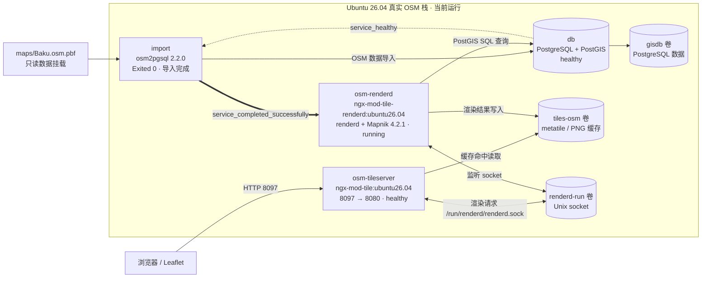
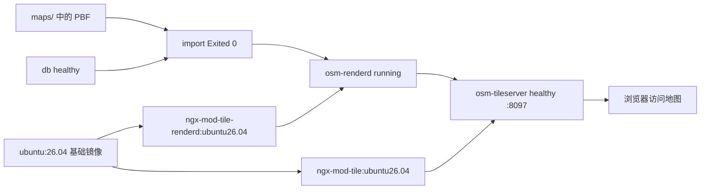

# OSM 地图服务部署架构与运行状态

本文使用 Mermaid 描述当前 Docker 部署。支持 Mermaid 的 Markdown 查看器可直接渲染架构图。

## Ubuntu 26.04 真实 OSM 栈

### 请求流程

1. 浏览器通过 Leaflet 请求 `/tiles/{z}/{x}/{y}.png`。
2. `osm-tileserver` 先检查 `tiles-osm` 中的 metatile 缓存。
3. 缓存有效时直接返回 PNG。
4. 缓存缺失或过期时，通过 `renderd-run` 卷中的 Unix socket 请求 `osm-renderd`。
5. renderd 调用 Mapnik，并从 PostGIS 查询地理数据。
6. 渲染结果写入 `tiles-osm`，再由 tileserver 返回给浏览器。

## 访问入口

| 地图栈 | URL |
|---|---|
| Ubuntu 24.04 demo | http://localhost:8090/ |
| Ubuntu 24.04 真实 OSM | http://localhost:8091/ |
| Ubuntu 26.04 demo | http://localhost:8096/ |
| Ubuntu 26.04 真实 OSM | http://localhost:8097/ |

## 启动依赖关系

## 运维边界

- PostgreSQL/PostGIS 使用独立服务镜像，不属于 Ubuntu 26.04 自定义镜像。
- Mapnik 是 renderd 的库，不单独运行容器。
- import 与 osm-renderd 复用同一镜像，但生命周期不同。
- demo 与真实 OSM 瓦片使用不同卷，避免占位瓦片污染真实地图。
- 停止服务可使用 `docker compose down`；不要在未备份时使用 `down -v`，以免删除数据库与瓦片缓存。
